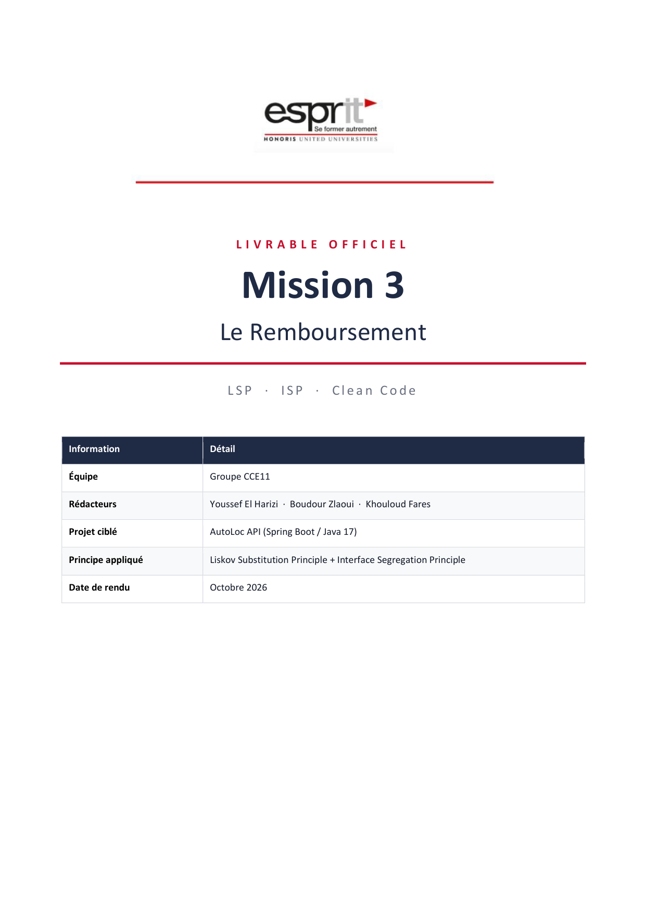

# AutoLoc API — Mission 3 : Le Remboursement

<div align="center">


<br/>

**Projet d'Architecture Logicielle & Clean Code (ESPRIT - 4CCE11)**  
*Application des principes de substitution de Liskov (LSP) et de ségrégation des interfaces (ISP)*

<br/>

[📹 Visionner la Démo Postman](#-vidéo-de-démonstration-postman) • [📄 Ouvrir le Rapport PDF](#-rapport-officiel-de-mission-3) • [⚡ Démarrage Rapide](#-démarrage-rapide)

</div>

---

## 📹 Vidéo de Démonstration Postman

Regardez ci-dessous la vidéo de démonstration complète de nos tests d'API Postman :

<div align="center">

<video src="postman.mp4" controls="controls" width="100%" style="max-height: 520px; border-radius: 10px; box-shadow: 0 6px 18px rgba(0,0,0,0.2);">
  Votre navigateur ne permet pas la lecture vidéo directe.
</video>

<br/>

👉 **[▶️ Cliquez ici pour ouvrir / télécharger la vidéo (postman.mp4)](./postman.mp4)**

</div>

---

## 📄 Rapport Officiel de Mission 3

Le livrable officiel complet au format PDF détaille la conception, les diagrammes UML & séquence, le code et l'analyse critique des prompts :

<div align="center">

<a href="Rapport_GrpYoussef.pdf" target="_blank" title="Cliquez pour ouvrir le rapport officiel PDF">
  
</a>

<br/><br/>

[](Rapport_GrpYoussef.pdf)
&nbsp;&nbsp;
[](Rapport_GrpYoussef.pdf)

</div>

---

## 📋 Informations du Projet

| Élément | Description |
| :--- | :--- |
| **Auteur principal** | **Youssef El Harizi** |
| **Groupe / Classe** | 4CCE11 — ESPRIT |
| **Mission** | Mission 3 : Refactorisation Clean Code du Remboursement (LSP + ISP) |
| **Stack Technique** | Java 17 · Spring Boot · Spring Data JPA · MySQL · OpenAPI (Swagger UI) · Postman |
| **Documentation Swagger** | [http://localhost:8082/api/swagger-ui.html](http://localhost:8082/api/swagger-ui.html) |

---

## ⚡ Démarrage Rapide

```bash
# 1. Cloner le dépôt
git clone https://github.com/YousefHarizi/Mission3_ArchitectureSI_GrpYoussef_4CCE11.git

# 2. Exécuter les tests unitaires (LSP & Application)
./mvnw clean test

# 3. Lancer l'application Spring Boot
./mvnw spring-boot:run
```

---

<div align="center">

**Youssef Harizi** · ESPRIT 2026

</div>
