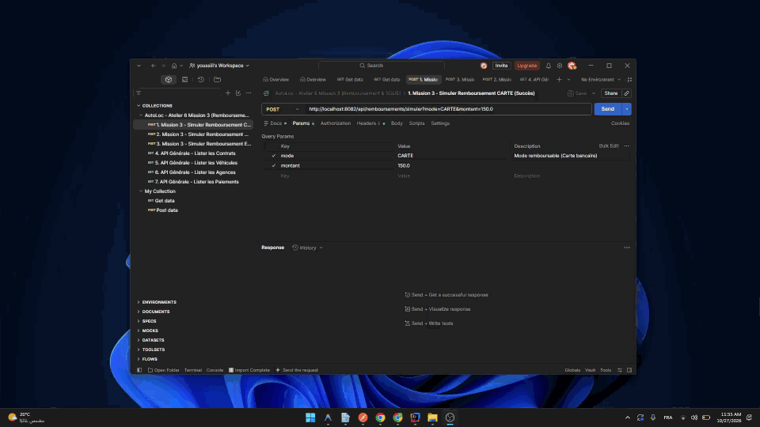
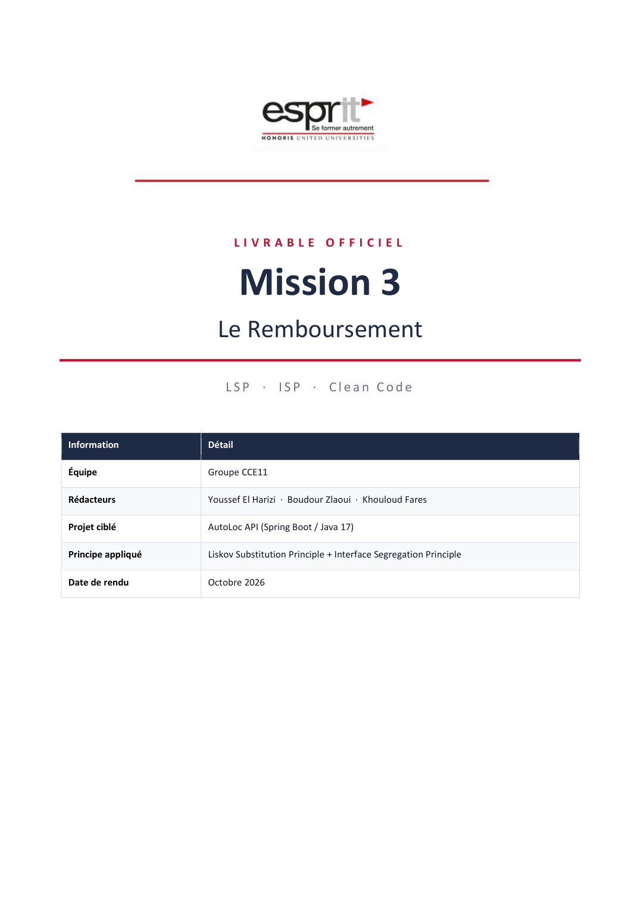
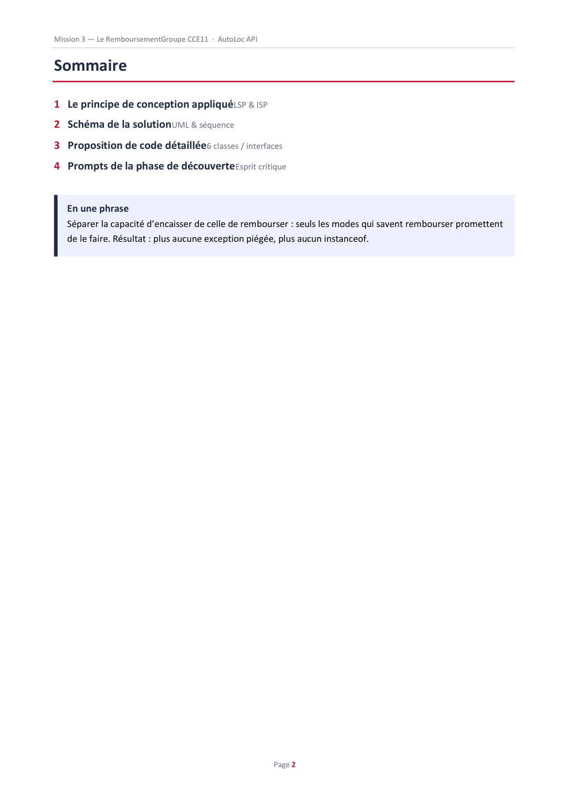
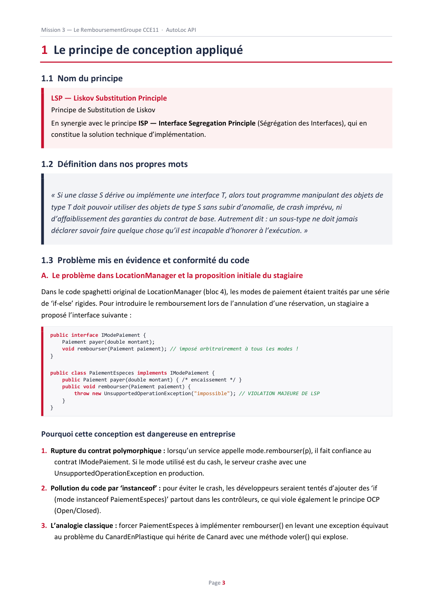
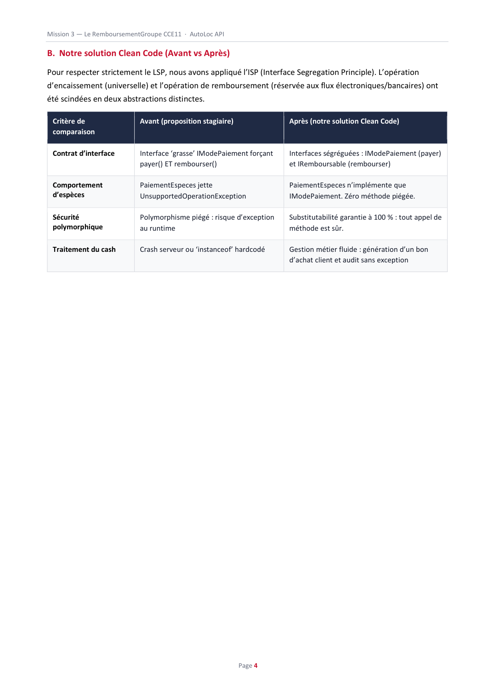

# AutoLoc API — Mission 3 : Le Remboursement

<div align="center">


<br/>

**Projet d'Architecture Logicielle & Clean Code (ESPRIT - 4CCE11)**  
*Application des principes de substitution de Liskov (LSP) et de ségrégation des interfaces (ISP)*

<br/>

[📹 Voir la Vidéo Postman](#-vidéo-de-démonstration-postman) • [📄 Consulter le Rapport PDF](#-rapport-officiel-de-mission-3) • [⚡ Démarrage Rapide](#-démarrage-rapide)

</div>

---

## 📹 Vidéo de Démonstration Postman

La démonstration ci-dessous présente l'exécution en direct des tests de remboursement (Carte, Virement, et gestion métier des Espèces) directement depuis Postman :

<div align="center">

<!-- Lecteur animé direct dans le README (aucun téléchargement nécessaire) -->


<br/><br/>

[](https://github.com/YousefHarizi/Mission3_ArchitectureSI_GrpYoussef_4CCE11/blob/main/postman.mp4)

</div>

---

## 📄 Rapport Officiel de Mission 3

Le rapport officiel complet est consultable directement dans votre navigateur via le lecteur GitHub :

<div align="center">

[](https://github.com/YousefHarizi/Mission3_ArchitectureSI_GrpYoussef_4CCE11/blob/main/Rapport_GrpYoussef.pdf)

<br/><br/>

<a href="https://github.com/YousefHarizi/Mission3_ArchitectureSI_GrpYoussef_4CCE11/blob/main/Rapport_GrpYoussef.pdf" title="Cliquer pour ouvrir le rapport dans GitHub">
  
</a>

</div>

<br/>

<details>
<summary><b>🔍 Cliquez ici pour feuilleter les pages clés du rapport directement dans ce README</b></summary>

<br/>

### Page 2 — Sommaire & Synthèse
<div align="center">
  
</div>

<br/>

### Page 3 — Problème & Principe LSP
<div align="center">
  
</div>

<br/>

### Page 4 — Solution Clean Code (Avant vs Après)
<div align="center">
  
</div>

</details>

---

## 📋 Informations du Projet

| Élément | Description |
| :--- | :--- |
| **Auteur principal** | **Youssef El Harizi** |
| **Groupe / Classe** | 4CCE11 — ESPRIT |
| **Mission** | Mission 3 : Refactorisation Clean Code du Remboursement (LSP + ISP) |
| **Stack Technique** | Java 17 · Spring Boot 4.0.8 · Spring Data JPA · MySQL · OpenAPI Swagger · Postman |
| **Documentation Swagger** | [http://localhost:8082/api/swagger-ui.html](http://localhost:8082/api/swagger-ui.html) |

---

## ⚡ Démarrage Rapide

```bash
# 1. Cloner le dépôt
git clone https://github.com/YousefHarizi/Mission3_ArchitectureSI_GrpYoussef_4CCE11.git

# 2. Exécuter les tests unitaires
./mvnw clean test

# 3. Lancer l'application Spring Boot
./mvnw spring-boot:run
```

---

<div align="center">

**Youssef Harizi** · ESPRIT 2026

</div>
