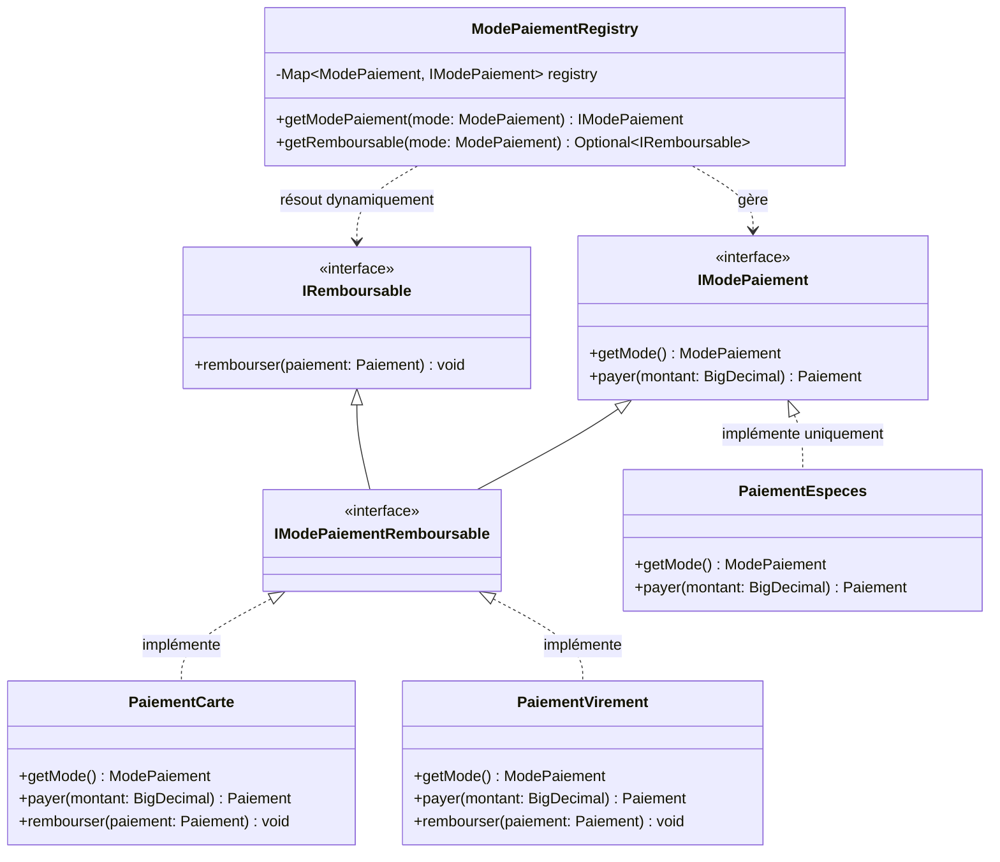
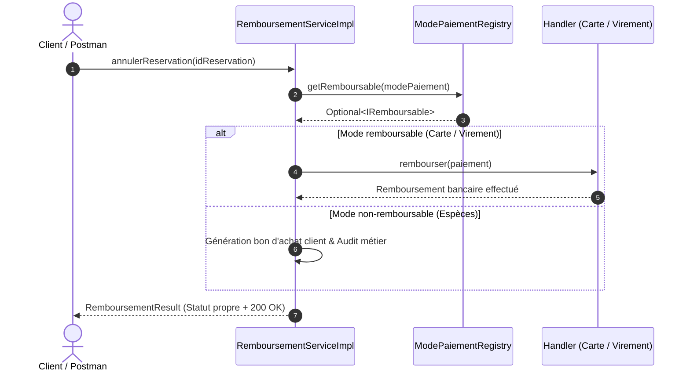

# AutoLoc API — Rapport Officiel de Mission 3 : Le Remboursement

<div align="center">


**LIVRABLE OFFICIEL — ARCHITECTURE LOGICIELLE**  
*LSP (Liskov Substitution Principle) · ISP (Interface Segregation Principle) · Clean Code*

</div>

---

## 📋 Informations Générales

| Information | Détail |
| :--- | :--- |
| **Équipe** | Groupe CCE11 |
| **Rédacteurs** | **Youssef El Harizi** · Boudour Zlaoui · Khouloud Fares |
| **Projet ciblé** | AutoLoc API (Spring Boot / Java 17) |
| **Principe appliqué** | **LSP** (Liskov Substitution Principle) + **ISP** (Interface Segregation Principle) |
| **Date de rendu** | Octobre 2026 |

> 💡 **En une phrase :**  
> *Séparer la capacité d’encaisser de celle de rembourser : seuls les modes qui savent rembourser promettent de le faire. Résultat : plus aucune exception piégée, plus aucun `instanceof` polluant.*

---

## 📑 Sommaire
1. [Démonstration Vidéo Postman](#-démonstration-vidéo-postman)
2. [Le Principe de Conception Appliqué (LSP & ISP)](#1-le-principe-de-conception-appliqué)
   - 1.1 Nom du principe
   - 1.2 Définition dans nos propres mots
   - 1.3 Problème mis en évidence & conformité du code
   - 1.4 Solution Clean Code (Avant vs Après)
3. [Schémas de la Solution](#2-schémas-de-la-solution)
   - 2.1 Diagramme de classes UML (Mermaid)
   - 2.2 Diagramme de séquence du remboursement (Mermaid)
4. [Proposition de Code Détaillée](#3-proposition-de-code-détaillée)
   - 3.1 Interface de base `IModePaiement` (ISP)
   - 3.2 Interface de capacité `IRemboursable`
   - 3.3 Interface combinée `IModePaiementRemboursable`
   - 3.4 Implémentation `PaiementEspeces` (LSP respecté)
   - 3.5 Registre centralisé `ModePaiementRegistry` (OCP & DIP)
   - 3.6 Service métier `RemboursementServiceImpl`
5. [Prompts de la Phase de Découverte (Esprit Critique)](#4-prompts-de-la-phase-de-découverte)
6. [Guide d'Installation et Exécution](#5-guide-dinstallation-et-exécution)

---

## 📹 Démonstration Vidéo Postman

Voici l'enregistrement démontrant l'exécution des tests bout-en-bout des APIs REST via Postman (remboursement par carte, virement bancaire et traitement métier des espèces avec bon d'achat) :

<div align="center">

<video src="./postman.mp4" controls="controls" width="100%" style="max-height: 540px; border-radius: 8px; box-shadow: 0 4px 12px rgba(0,0,0,0.15);">
  Votre navigateur ne permet pas la lecture directe de cette vidéo. 
  <a href="./postman.mp4">Cliquez ici pour télécharger ou visionner postman.mp4</a>.
</video>

<br/>

👉 **[▶️ Visionner la vidéo directement (postman.mp4)](./postman.mp4)**

</div>

### Scénarios validés dans la vidéo :
1. **Annulation avec Paiement CARTE** : Re-crédit automatique et immédiat sur la carte bancaire via passerelle monétique (`200 OK`).
2. **Annulation avec Paiement VIREMENT** : Émission de l'ordre de virement bancaire de remboursement (`200 OK`).
3. **Annulation avec Paiement ESPÈCES** : Zéro exception technique (`UnsupportedOperationException` éliminée), audit métier tracé, et génération automatique d'un **bon d'achat client** de même valeur (`200 OK`).

---

## 1. Le Principe de Conception Appliqué

### 1.1 Nom du principe
- **LSP — Liskov Substitution Principle** (Principe de Substitution de Liskov).
- En synergie avec **ISP — Interface Segregation Principle** (Ségrégation des Interfaces), qui en constitue la solution technique d'implémentation élégante.

### 1.2 Définition dans nos propres mots
> *« Si une classe $S$ dérive ou implémente une interface $T$, alors tout programme manipulant des objets de type $T$ doit pouvoir utiliser des objets de type $S$ sans subir d’anomalie, de crash imprévu, ni d’affaiblissement des garanties du contrat de base. Autrement dit : un sous-type ne doit jamais déclarer savoir faire quelque chose qu’il est incapable d’honorer à l’exécution. »*

### 1.3 Problème mis en évidence et conformité du code

#### A. Le problème dans `LocationManager` et la proposition initiale du stagiaire
Dans le code spaghetti original de `LocationManager` (bloc 4), les modes de paiement étaient traités par une série de `if-else` rigides. Pour introduire le remboursement lors de l’annulation d’une réservation, un stagiaire avait proposé l'interface suivante :

```java
// ❌ CONCEPTION PIÉGÉE DU STAGIAIRE
public interface IModePaiement {
    Paiement payer(double montant);
    void rembourser(Paiement paiement); // Imposé arbitrairement à tous les modes !
}

public class PaiementEspeces implements IModePaiement {
    public Paiement payer(double montant) { /* encaissement */ }
    
    public void rembourser(Paiement paiement) {
        // ❌ VIOLATION MAJEURE DE LSP
        throw new UnsupportedOperationException("impossible");
    }
}
```

#### Pourquoi cette conception est dangereuse en entreprise :
1. **Rupture du contrat polymorphique** : Lorsqu’un service appelle `mode.rembourser(p)`, il fait confiance au contrat `IModePaiement`. Si le mode utilisé est du cash, le serveur crashe avec une `UnsupportedOperationException` en production.
2. **Pollution du code par `instanceof`** : Pour éviter le crash, les développeurs sont tentés d'ajouter des `if (mode instanceof PaiementEspeces)` dans les contrôleurs et services, ce qui viole également le principe **OCP** (*Open/Closed Principle*).
3. **L’analogie classique** : Forcer `PaiementEspeces` à implémenter `rembourser()` en levant une exception équivaut au problème classique du `CanardEnPlastique` qui hérite de `Canard` avec une méthode `voler()` qui explose.

### 1.4 Notre solution Clean Code (Avant vs Après)

| Critère de comparaison | Avant (proposition stagiaire) | Après (notre solution Clean Code) |
| :--- | :--- | :--- |
| **Contrat d’interface** | Interface « grasse » `IModePaiement` forçant `payer()` **ET** `rembourser()` | **Interfaces ségréguées (ISP)** : `IModePaiement` (payer) et `IRemboursable` (rembourser) |
| **Comportement d’espèces** | `PaiementEspeces` jette `UnsupportedOperationException` | `PaiementEspeces` n’implémente que `IModePaiement`. **Zéro méthode piégée**. |
| **Sécurité polymorphique** | Polymorphisme piégé : risque d’exception inattendue au runtime | **Substitutabilité garantie à 100 % (LSP)** : tout appel de méthode est sûr et garanti. |
| **Traitement du cash** | Crash serveur ou vérifications `instanceof` hardcodées | **Gestion métier fluide** : émission d'un bon d'achat client et audit sans exception technique. |

---

## 2. Schémas de la Solution

L’architecture repose sur la séparation nette des rôles, l’utilisation d’interfaces de capacité et d’un registre dynamique injecté par constructeur Spring (conforme aux exigences de testabilité et SonarQube S6813).

### 2.1 Diagramme de classes UML de la conception



### 2.2 Diagramme de séquence du traitement du remboursement



---

## 3. Proposition de Code Détaillée

### 3.1 Interface de base `IModePaiement` (ISP)
📍 *Emplacement : `src/main/java/tn/esprit/elharizi/service/location/payment/IModePaiement.java`*

```java
package tn.esprit.elharizi.service.location.payment;

import java.math.BigDecimal;
import tn.esprit.elharizi.domain.ModePaiement;
import tn.esprit.elharizi.domain.Paiement;

public interface IModePaiement {
    ModePaiement getMode();
    Paiement payer(BigDecimal montant);
}
```

### 3.2 Interface de capacité `IRemboursable`
📍 *Emplacement : `src/main/java/tn/esprit/elharizi/service/location/payment/IRemboursable.java`*

```java
package tn.esprit.elharizi.service.location.payment;

import tn.esprit.elharizi.domain.Paiement;

public interface IRemboursable {
    void rembourser(Paiement paiement);
}
```

### 3.3 Interface combinée `IModePaiementRemboursable`
📍 *Emplacement : `src/main/java/tn/esprit/elharizi/service/location/payment/IModePaiementRemboursable.java`*

```java
package tn.esprit.elharizi.service.location.payment;

public interface IModePaiementRemboursable extends IModePaiement, IRemboursable {
}
```

### 3.4 Implémentation `PaiementEspeces` (conforme LSP — aucune exception jetée)
📍 *Emplacement : `src/main/java/tn/esprit/elharizi/service/location/payment/PaiementEspeces.java`*

```java
package tn.esprit.elharizi.service.location.payment;

import java.math.BigDecimal;
import java.time.LocalDate;
import org.springframework.stereotype.Component;
import tn.esprit.elharizi.domain.ModePaiement;
import tn.esprit.elharizi.domain.Paiement;

@Component
public class PaiementEspeces implements IModePaiement {

    @Override
    public ModePaiement getMode() {
        return ModePaiement.ESPECES;
    }

    @Override
    public Paiement payer(BigDecimal montant) {
        System.out.println("[ESPECES] Encaissement en especes effectue a l'agence.");
        return Paiement.builder()
                .datePaiement(LocalDate.now())
                .modePaiement(ModePaiement.ESPECES)
                .montant(montant)
                .build();
    }
    // N'implémente PAS IRemboursable : zéro méthode inutile ou piégée !
}
```

### 3.5 Registre centralisé `ModePaiementRegistry` (respect OCP & DIP)
📍 *Emplacement : `src/main/java/tn/esprit/elharizi/service/location/payment/ModePaiementRegistry.java`*

```java
package tn.esprit.elharizi.service.location.payment;

import java.util.*;
import org.springframework.stereotype.Component;
import tn.esprit.elharizi.domain.ModePaiement;

@Component
public class ModePaiementRegistry {

    private final Map<ModePaiement, IModePaiement> registry = new EnumMap<>(ModePaiement.class);

    // Injection par constructeur (SonarQube S6813 compliant)
    public ModePaiementRegistry(List<IModePaiement> modes) {
        for (IModePaiement mode : modes) {
            if (mode.getMode() != null) {
                registry.put(mode.getMode(), mode);
            }
        }
    }

    public IModePaiement getModePaiement(ModePaiement mode) {
        IModePaiement handler = registry.get(mode);
        if (handler == null) {
            throw new IllegalArgumentException("Mode non supporte : " + mode);
        }
        return handler;
    }

    public Optional<IRemboursable> getRemboursable(ModePaiement mode) {
        IModePaiement handler = registry.get(mode);
        if (handler instanceof IRemboursable remboursable) {
            return Optional.of(remboursable);
        }
        return Optional.empty();
    }
}
```

### 3.6 Service métier `RemboursementServiceImpl`
📍 *Emplacement : `src/main/java/tn/esprit/elharizi/service/location/payment/RemboursementServiceImpl.java`*

```java
package tn.esprit.elharizi.service.location.payment;

import lombok.RequiredArgsConstructor;
import org.springframework.stereotype.Service;
import tn.esprit.elharizi.domain.Paiement;

@Service
@RequiredArgsConstructor
public class RemboursementServiceImpl implements IRemboursementService {

    private final ModePaiementRegistry modePaiementRegistry;

    @Override
    public RemboursementResult traiterRemboursement(Paiement paiement) {
        if (paiement == null) {
            return RemboursementResult.aucunPaiement();
        }

        Optional<IRemboursable> remboursableOpt =
                modePaiementRegistry.getRemboursable(paiement.getModePaiement());

        if (remboursableOpt.isPresent()) {
            remboursableOpt.get().rembourser(paiement);
            return RemboursementResult.succes(paiement.getMontant(), paiement.getModePaiement());
        } else {
            // Cas des ESPECES : gestion propre SANS exception technique
            System.out.println("[AUDIT GESTION] Paiement en especes : remboursement cash impossible a distance. Bon d'achat genere.");
            return RemboursementResult.nonRemboursableEspeces();
        }
    }
}
```

---

## 4. Prompts de la Phase de Découverte

| Prompt (tel quel) | Ce que nous en avons retenu | Ce que nous avons corrigé ou écarté, et pourquoi |
| :--- | :--- | :--- |
| **1.** *« Dans un système de location, un stagiaire a écrit une interface IModePaiement avec payer() et rembourser(). Pour PaiementEspeces, il lance throw new UnsupportedOperationException("impossible"). Quel principe SOLID est violé et pourquoi ? »* | Le principe violé est le **LSP** (*Liskov Substitution Principle*). Un sous-type ne doit jamais refuser une méthode déclarée par son abstraction parente ni lever d’exception inattendue qui casserait le polymorphisme du code appelant. | L’IA suggérait d’attraper l’exception dans un bloc `try/catch` au niveau du contrôleur. Nous avons **totalement ÉCARTÉ** cette suggestion car utiliser des exceptions pour gérer un cas métier prévisible est un anti-pattern notoire. |
| **2.** *« Comment corriger cette violation de Liskov sans forcer le code client à faire des tests ‘if (mode instanceof PaiementEspeces)’ ? »* | La solution élégante consiste à combiner **LSP avec l’ISP** : séparer la capacité d’encaisser (`IModePaiement`) de la capacité de rembourser (`IRemboursable`). Seuls les modes supportant le remboursement implémentent cette capacité. | L’IA proposait d’ajouter un booléen `boolean estRemboursable()` dans `IModePaiement`. Nous avons **ÉCARTÉ** cette piste car elle laissait une méthode `rembourser()` vide dans `PaiementEspeces`. L’interface de capacité est bien plus propre et typée. |
| **3.** *« Comment intégrer cette architecture dans une application Spring Boot respectant l’injection par constructeur et la règle SonarQube S6813 ? »* | Utiliser un composant `ModePaiementRegistry` injecté par constructeur (`@RequiredArgsConstructor`) avec `List<IModePaiement>`, qui mappe dynamiquement les stratégies sans couplage fort. | L’IA proposait au départ d’injecter chaque bean avec `@Qualifier("especes")` directement dans le service. Nous l’avons **CORRIGÉ** en passant par un `Registry` car l’injection fixe aurait violé le principe **OCP** lors de l’ajout futur d’autres modes (ex : Wallet). |

### 📌 Synthèse de la Démarche
Notre travail a démontré qu’une IA peut identifier le nom d’un principe, mais que seul **l’esprit critique du concepteur logiciel** permet d’éliminer les mauvaises solutions (*try/catch d'exception métier, instanceof polluant*) au profit d’une architecture extensible et conforme aux règles professionnelles (**LSP + ISP + SonarQube S6813**).

---

## 5. Guide d'Installation et Exécution

### Prérequis
- Java 17+
- Maven 3.8+ (ou utiliser `./mvnw`)
- MySQL 8+ (Base de données : `autoloc_db`)

### Lancement du projet
```bash
# Compiler et lancer les tests unitaires
./mvnw clean test

# Démarrer le serveur Spring Boot (port 8082)
./mvnw spring-boot:run
```

### Documentation API Swagger
Une fois l'application démarrée, retrouvez la documentation OpenAPI interactive sur :
- **Swagger UI** : [http://localhost:8082/api/swagger-ui.html](http://localhost:8082/api/swagger-ui.html)
- **OpenAPI JSON Spec** : [http://localhost:8082/api/v3/api-docs](http://localhost:8082/api/v3/api-docs)

---

<div align="center">

**Youssef El Harizi · Boudour Zlaoui · Khouloud Fares**  
*Classe : 4CCE11 — ESPRIT*

</div>
